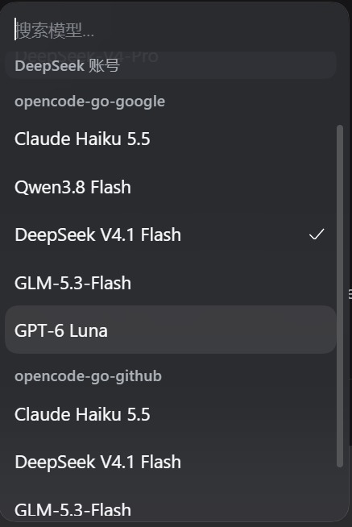
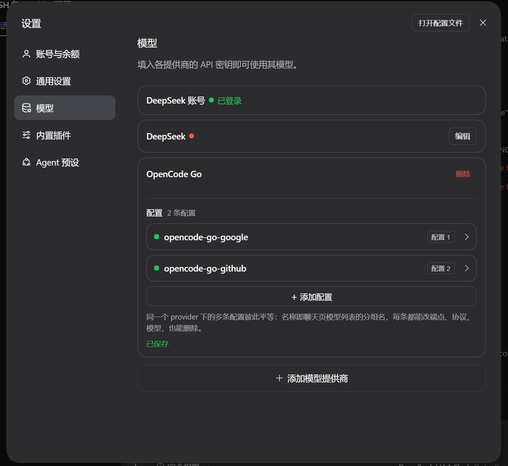

# ProviderEnhance

[](https://github.com/elliotmasheal/dsh-provider-enhance/actions/workflows/ci.yml)
[](LICENSE)
[](https://github.com/elliotmasheal/dsh-provider-enhance#compatibility-and-risks)

**English** | [Chinese](README.zh.md)

**One third-party provider, many named configurations.** DeepSeek Harness (DSH)
binds one credential per provider route; ProviderEnhance turns a provider
profile into a container of equally editable configurations — each with its own
name, API key, endpoint, wire protocol and model list. Chat's model picker
groups models by those configuration names.

> Built and tested against **DSH Desktop 0.2.1-rc.3** on Windows. The adapter
> half is a patched build of the bundled `@deepseek-ai/dsh-llm-pi-ai`; read
> [Compatibility and risks](#compatibility-and-risks) before upgrading DSH.

Maintained by [Youpeng (@elliotmasheal)](https://github.com/elliotmasheal).

## Screenshots



*The Models page: one provider card holding several peer configurations, each
with its own key, endpoint, protocol and model list.*



*The chat model picker: models are grouped under configuration names
(`opencode-go-google`, `opencode-go-github`, …).*

## Why

A model route in DSH is one `provider` id with one display name, one credential
reference and one model list; registering the same route twice fails with
`DUPLICATE_ADAPTER`. That makes "two subscriptions of the same provider"
impossible with the stock UI. ProviderEnhance keeps **one** provider id in
configuration and expands its `accounts` into internal routes at load time, so
each configuration gets its own credential and its own chat group while the
Models page still shows a single provider row.

## Install

Requirements: DSH Desktop 0.2.x with the desktop profile, and the Node/pnpm that
DSH ships (the script finds them). Node 22+ is only needed when you run the
script with your own Node.

```sh
git clone https://github.com/elliotmasheal/dsh-provider-enhance.git
cd dsh-provider-enhance
node scripts/install.mjs --profile desktop
```

The installer:

1. links `packages/adapter` as `@deepseek-ai/dsh-llm-pi-ai` in the profile, so the
   loader resolves the patched adapter for the existing `llm-pi-ai` row;
2. links `packages/ui` and appends it to `dsh.profile.bundles`;
3. runs the profile's own `pnpm install` (backups of `package.json` /
   `pnpm-lock.yaml` are written first).

Restart DSH Desktop afterwards. The profile links to this clone, so keep the
directory where it is (re-run the installer if you move it).

Options:

- `--dry-run` prints the manifest changes without writing them.
- `--no-install` skips pnpm; run `pnpm install` in the profile yourself.
- `--home <DSH_HOME>` for a non-default harness home.
- `--profile <name>` for a profile other than `desktop`.

The installer edits the profile manifest, so review it with `--dry-run` first if
you keep the profile under version control.

## Use

1. **Settings → Models → Add model provider**, pick a third-party provider
   (for example `opencode-go`) and paste the first subscription's API key.
2. Open that provider's card. Its configurations are listed collapsed; use
   **+ Add configuration** to add the next subscription.
3. Click a configuration row to expand it:
   - **name** — the chat group name (unique within the provider);
   - **key** — stored write-only in DSH's credential store;
   - **Customized settings** — endpoint, wire protocol, model list with
     **Fetch models** (catalog lookup for catalog providers, `GET {baseURL}/models`
     for custom endpoints);
   - **Save**, **Delete** — configurations are peers; deleting the first one
     promotes the next without touching the provider's name.
4. Chat: the model picker shows one group per configuration name. The
   provider's own product name is only used as the Models-page row title.

## Configuration model

```yaml
providers:
  opencode-go:                 # the only route id in configuration
    models: [...]              # provider defaults, inherited by configurations
    accounts:                  # configuration 1 … N, in order
      - name: opencode-go-google
        apiKeyEnv: OPENCODE_GO_API_KEY
      - name: opencode-go-github
        apiKeyEnv: OPENCODE_GO_2_API_KEY
      - name: opencode-go-work
        apiKeyEnv: OPENCODE_GO_3_API_KEY
        baseURL: https://opencode.ai/zen/go
        api: openai-completions
```

- `accounts[0]` is served on the base route id (`opencode-go`), so
  `agent-default-model` and existing session logs keep working; entries 2…N
  expand to internal routes `opencode-go#2`, `#3` that inherit the profile and
  catalog.
- Every configuration of an installed catalog provider — including the base one
  — resolves through that catalog. The catalog supplies each known model's
  default protocol, endpoint, compatibility and metadata; an account's `api` /
  `baseURL` win over those defaults when set, and `models` replaces the served
  list. Configurations therefore behave identically instead of configuration 1
  forcing its own protocol.
- An account's `models` / `compat` / `headers` / `retryPolicy` override the
  profile defaults; blank values inherit. `headers` merge field by field with
  the provider's headers.
- Configuration names must be unique per provider (client and adapter enforce
  it). Deleting the last configuration removes the provider entry.
- Configuration 1's display name is stored as `configName`, so the provider's
  product name never doubles as a chat group name.

## Request headers

Every provider request carries the harness identity, the configuration's
headers, and the protocol headers pi-ai adds:

- `user-agent` is always `deepseek-harness/<version> (+url)`. A configured value
  is dropped so attribution cannot be suppressed.
- Configuration headers merge with the provider's, so one header added on a
  configuration does not remove the provider-level ones.
- On OpenCode catalog routes (`opencode-go`, `opencode`) pi-ai sends
  `x-opencode-session` with the current DSH session id. That name is reserved:
  a configured value is dropped, so every conversation keeps its own id. The
  id is stable for the life of a session (including resume, compaction and the
  session-title request) and differs for a new session or a subagent.
- Models on the Responses protocol also get `x-client-request-id` with the same
  session id from pi-ai.
- A hand-declared provider keeps its own `headers` untouched, including a
  custom session header, because no OpenCode provider wrapper is involved.

## Compatibility and risks

- **Pinned to DSH 0.2.1-rc.3.** `packages/adapter/lib/index.js` is a built
  artifact extracted from that build and patched. After a DSH upgrade, re-run
  the upstream extraction and re-apply the patches in
  [docs/upgrading.md](docs/upgrading.md); otherwise the plugin fails to load or
  loses the accounts feature.
- **The adapter overrides the bundled package by name**, which is the only way a
  plugin can replace it; this also means the override must be re-linked after a
  DSH upgrade. The override affects the whole profile, not only providers that
  use configurations.
- **The Models page's per-provider Edit button** is hidden for providers with
  more than one configuration by a DOM lookup (`*_rowActions`). If a future
  build renames that class, the button reappears; nothing else depends on it.
- **The stock Add model provider dropdown** only lists unconfigured providers.
  Adding another configuration of an existing provider happens inside its card
  (`+ Add configuration`); this is a page-internal filter that slots cannot
  extend.
- **Provider profiles created by an older single-provider setup** are not
  migrated automatically: add a configuration and paste the existing key once.
- **Platform support:** tested on Windows only. The scripts use portable Node
  APIs but macOS and Linux are unverified.
- **Security:** the plugin runs in-process with the user's permissions and
  writes to the DSH profile. See [SECURITY.md](SECURITY.md).

This project is not affiliated with, endorsed by, or sponsored by DeepSeek.

## Troubleshooting

Run the diagnostic first:

```sh
node scripts/doctor.mjs --profile desktop
```

It checks the profile manifest, the linked adapter and UI bundle, the adapter
patch markers, the `accounts` blocks, and the installed DSH version.

Common issues:

| Symptom | Likely cause |
| --- | --- |
| The Models page shows no configuration UI | The UI bundle is not in `dsh.profile.bundles`; re-run the installer and restart. |
| Startup fails with "unexpected field `accounts`" | The patched adapter is no longer linked (for example after a DSH upgrade); re-run the installer. |
| DSH does not start after uninstalling | `accounts` blocks remain in the profile's `cordis.patch.yml`; run `node scripts/uninstall.mjs` again or remove them by hand. |
| Two configurations share a name | Names must be unique per provider; rename one. |
| `Fetch models` returns nothing | The endpoint answered no models; check the base URL and key, or add models manually. |

## Uninstall

```sh
node scripts/uninstall.mjs --profile desktop
```

The script removes the adapter and UI dependencies, deselects the bundle, and —
because the stock adapter rejects unknown fields — removes the `accounts:`
blocks from the profile's `cordis.patch.yml` after writing a backup. Pass
`--keep-accounts` to leave them in place. Restart DSH afterwards.

## Repository layout

| Path | What |
| --- | --- |
| `packages/adapter` | Patched `@deepseek-ai/dsh-llm-pi-ai` (drop-in override; not published) |
| `packages/ui` | `dsh-provider-enhance` Web client bundle and locale dictionaries |
| `patches/0001-accounts-and-headers.patch` | the adapter diff against the published upstream release |
| `scripts/install.mjs`, `scripts/uninstall.mjs`, `scripts/doctor.mjs` | profile installer, remover and diagnostics |
| `scripts/sync-adapter.mjs` | rebuilds `packages/adapter/lib/index.js` from npm + patches |
| `scripts/check.mjs` | offline syntax/manifest/hygiene checks (also runs in CI) |
| `tests/headers.test.mjs` | fake-fetch regression tests for the header contract |
| `docs/upgrading.md` | how to re-patch the adapter after a DSH update |
| `docs/architecture.md` | how the loader override, slots and route expansion fit together |

## Development

```sh
node scripts/check.mjs
npm test                       # header tests; need a DSH install (or peers below)
node scripts/install-test-peers.mjs   # fetch the published DSH peer packages
DSH_APP_NODE_MODULES=.test-dsh/node_modules npm test
node scripts/sync-adapter.mjs --check # adapter == npm upstream + patches
node scripts/pack-check.mjs           # published tarball contents
```

`check.mjs` verifies JavaScript syntax, manifests, patch markers and scans the
tree for personal absolute paths or secret-like strings. CI runs the same
checks on Linux and Windows, and runs the header tests against the published
DSH `0.2.1-rc.3` packages.

Contributions are welcome; see [CONTRIBUTING.md](CONTRIBUTING.md). Please report
security issues privately as described in [SECURITY.md](SECURITY.md).

## License

MIT. `packages/adapter/lib/index.js` is a modified copy of
`@deepseek-ai/dsh-llm-pi-ai` (MIT, Copyright (c) 2026 DeepSeek). See
[LICENSE](LICENSE) and [NOTICE.md](NOTICE.md).
