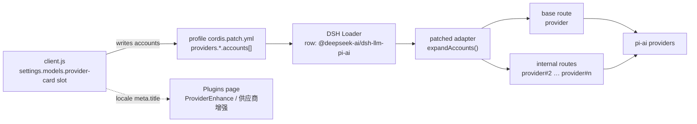

# Architecture

ProviderEnhance is two packages that must ship together: a Web client bundle and
a patched model adapter. This page explains why both exist and how data flows.

## The constraint

A DSH model route is one `provider` id with one `displayName`, one credential
reference (`apiKeyEnv`) and one model list. Registering the same route twice
fails with `DUPLICATE_ADAPTER`, so "two subscriptions of the same provider"
cannot be expressed through configuration alone. The Models page also has one
card per route, and only one save path per card.

## The shape of the solution

1. **UI** (`packages/ui/client.js`) registers a slot occupant on
   `settings.models.provider-card` for `llm-pi-ai`. It renders the configuration
   list, edits the profile through the settings/credential services, and hides
   the stock Edit button when a provider has several configurations.
2. **Configuration** keeps exactly one provider entry. Each configuration is an
   entry in `accounts`; `accounts[0]` has no extra route, later entries expand.
3. **Adapter** (`packages/adapter`) replaces the bundled
   `@deepseek-ai/dsh-llm-pi-ai` by name because a plugin cannot otherwise change
   how the `llm-pi-ai` row resolves providers. On load it expands `accounts`
   into servable routes and adjusts headers.
4. **Loader override**: the profile dependency
   `"@deepseek-ai/dsh-llm-pi-ai": "link:…/packages/adapter"` makes the patched
   copy the module the existing row imports.

## Route expansion

- `accounts` is absent: the provider behaves exactly like stock DSH.
- `accounts[0]`: keeps the base route id (`opencode-go`), receives
  `configName = accounts[0].name`; `providerInfo()` reports `configName` so the
  chat group is named after the configuration, not the product.
- `accounts[n > 0]`: becomes `provider#n`, inheriting the base profile through
  `overlayAccount()`; `displayName` is the configuration name.
- Blank values (`models: []`, `headers: {}`) mean *inherit*, not "replace with
  empty".
- Configuration names are trimmed and must be unique inside a provider; both the
  UI and the adapter reject duplicates (`expandAccounts()` throws).

## Catalog and protocol handling

Every configuration of an installed catalog provider resolves through that
catalog, including configuration 1. The catalog supplies each known model's
default protocol, endpoint, compatibility and metadata. A configuration's
explicit `api` / `baseURL` win over those defaults, and `models` replaces the
served list. `catalogServesModels()` keeps a hand-declared provider when the
catalog cannot serve a forced protocol, instead of failing dispatch.

## Headers

`requestHeaders()` merges provider and configuration headers, then adds the
harness attribution headers. On OpenCode routes (`opencode`, `opencode-go`) it
also reserves `x-opencode-session`, so a configured value can never freeze the
per-conversation id that pi-ai injects. See `tests/headers.test.mjs`.

## Display name

DSH reads plugin display metadata without evaluating JavaScript: for the package
root it tries `<specifier>/locale/en.json` and the sibling dictionaries, then
falls back to `package.json` `name` / `description`. ProviderEnhance ships
`packages/ui/locale/en.json` (`ProviderEnhance`) and `locale/zh.json`
(`供应商增强`); the package name stays `dsh-provider-enhance` because it is also
the client module id and the patch row name.

## Why the adapter override is the fragile part

The bundled adapter is replaced by name, so:

- the patched file is pinned to a DSH release (`0.2.1-rc.3`);
- after a DSH upgrade the extraction and patches must be re-applied
  ([upgrading.md](upgrading.md));
- the override affects the whole profile, not just multi-configuration
  providers.

The long-term goal is to upstream the `accounts` model so this fork can shrink
to the UI bundle.
